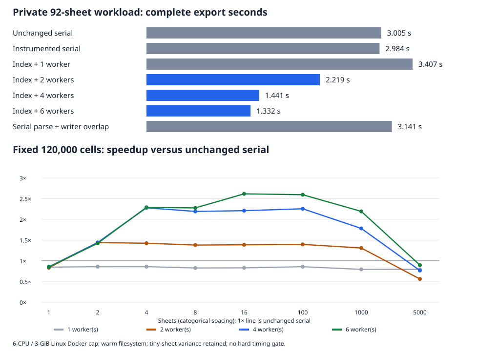

# Parallel sheet parsing: bounded research for issue #42

> [!NOTE]
> Research authored by a delegated GPT-6.1 Sol via Codex agent and submitted on viell's behalf
> by the parent GPT-6.1 Sol via Codex agent. Viell has not reviewed this report. This is an
> experiment, not a production implementation or release decision.

**Recommendation: defer production adoption.** Sheet parsing can provide a useful end-to-end
improvement: the authorized private 92-sheet case improved from **3.005 s to 1.332 s median
(2.26×)** with six workers. Four workers reached **1.441 s (2.08×)**. The same design regresses
single-sheet, skewed and very small-sheet cases, retains substantially more memory, and has
confirmed prototype compatibility failures. Preserve the current serial implementation and
release scope. A separately assigned implementation could be justified for substantial,
reasonably balanced multi-sheet inputs after the conditions below are addressed.

This investigates [issue #42](https://github.com/viell-dev/slop-ods2tsv/issues/42). It establishes
no new supported option, dependency, platform promise, stable goal or release blocker. No
production defect was established by this investigation; the failures described here belong to
the scratch prototype.

## Source, environment and method

The unchanged baseline is the beta.1/main Git archive at
[`e1807728d6e92b699cab0a859b29092da4946309`](https://github.com/viell-dev/slop-ods2tsv/tree/e1807728d6e92b699cab0a859b29092da4946309).
The product checkout was never edited or used as the experiment's build tree. Parent-owned RC
and stable metadata/branch work proceeded independently.

Both executables were built once with **Rust 1.99.1**, release optimization and the existing
thin LTO configuration, for **x86_64-unknown-linux-gnu**. This measures a Linux source build,
not a Windows or distributed musl artifact. The scratch tree adds explicit **Rayon 1.12.0** and
**quick-xml 0.42.0**, a private research module, an environment-controlled export hook, and
bounded XML materialization. The original xml-rs 1.4.0 reader and ZIP 9.4.1 remain in use.
Exact source, lockfile, patch, build recipe and raw results are retained.

The host ran Linux 6.18.60 on an **i7-4930K, 6 physical / 12 logical CPUs**, with 15 GiB RAM.
About 13–14 GiB was available at setup; swap was unused. Each disposable container had a
**6-CPU quota and 3-GiB memory cap**, without CPU affinity or frequency locking. No other
containers were observed during the experiments. Host load was initially near zero and around
1–1.5 during later observations. Shared-host scheduling, turbo and filesystem effects remain
limitations; this was not a controlled dedicated benchmark machine.

Each timed child performs the **complete export**: process startup, package inspection,
ZIP read/decompression and CRC/EOF checks, optional materialization/indexing/validation, pool
creation, original sheet parsing, ordered TSV output, metadata and both manifests. Fixture
generation, comparison and output deletion occur outside the timer. Runs use the normal flush
contract, warm filesystem caches and fresh output directories; there is no fsync or cold-cache
claim. GNU time supplies converter CPU time and peak RSS; external monotonic time supplies
elapsed time. CPU values have 0.01-second resolution.

There is one warmup per variant, then three rotating-order measured rounds. The 5,000-sheet,
empty-tail, output-heavy and merged cases have five rounds. All warmups, outliers and variance
are retained: **420 timed exports, including 329 measured exports**. No timing gate or universal
worker threshold is inferred from these samples. Separate instrumentation is reported alongside
the unchanged executable because instrumentation/code layout itself can affect timing.

## What was compared

| Variant | Work performed |
| --- | --- |
| Serial | Unchanged full exporter, independently built from the archive |
| Serial + timers | Original synchronous read/emit/write path with phase measurements |
| Index + 1 | Full bounded XML read; XML-aware scan/index and non-sheet validation; same reader in one Rayon worker; ordered original writer |
| Index + 2/4/6 | Same indexing and reader as the one-worker control, using a fresh bounded pool per export |
| Writer overlap | One original serial parser and one ordered writer, with a capacity-one channel and joined producer |

The index uses `NsReader` XML events and byte positions, rather than raw table-string searches.
Each fragment includes its original ancestor start/end tags to retain inherited namespace
declarations and wrapper depth. The original reader validates/projects each fragment; a skeleton
retaining non-sheet content is checked separately by the original reader. Original-document
depth is checked during indexing. Non-UTF-8 bytes or a non-UTF-8 declaration fall back to the
original reader after materialization. This is deliberately incomplete compatibility work.

Indexed `par_iter().map(...).collect::<Vec<_>>()` runs parsing in parallel and retains source
order. Batches hold at most twice the worker count in active/completed `Sheet` results. Each
batch joins before the controller invokes the unchanged `Run::write` in order. Workers do not
write files. Consequently filename allocation, warnings, merge reservations, the exact shared
output counter and manifests retain their original coordinator. This is actual parallel parsing;
there is no mutex disguising a serial parser.

Rayon's [`par_bridge`](https://docs.rs/rayon/1.12.0/rayon/iter/trait.ParallelBridge.html)
synchronizes calls to `next()` and does not guarantee source order. Bridging completed sheets
from the present reader would leave its expensive parsing serial. The
[indexed iterator API](https://docs.rs/rayon/1.12.0/rayon/iter/trait.IndexedParallelIterator.html)
supports splitting known indexed input; the experiment uses indexed fragments and ordered
collection. Pool construction uses the verified
[`ThreadPoolBuilder` API](https://docs.rs/rayon/1.12.0/rayon/struct.ThreadPoolBuilder.html).

## Complete-export measurements

Seconds, medians. `1/2/4/6` include indexing and the respective worker count. Dense cases have
**exactly 120,000 ordinary cells and 20,000 row templates** each; sheet count changes their
distribution. The skewed case puts 109,080 cells in one sheet and 120 cells in each of 91 others.

| Workload | Serial | 1 | 2 | 4 | 6 | Writer overlap | Rounds |
| --- | ---: | ---: | ---: | ---: | ---: | ---: | ---: |
| Dense, 1 sheet | 0.622 | 0.733 | 0.746 | 0.728 | 0.732 | 0.648 | 3 |
| Dense, 2 sheets | 0.622 | 0.726 | 0.432 | 0.432 | 0.437 | 0.642 | 3 |
| Dense, 4 sheets | 0.618 | 0.719 | 0.434 | 0.271 | 0.270 | 0.639 | 3 |
| Dense, 8 sheets | 0.600 | 0.726 | 0.435 | 0.274 | 0.264 | 0.633 | 3 |
| Dense, 16 sheets | 0.602 | 0.725 | 0.434 | 0.273 | 0.230 | 0.631 | 3 |
| Dense, 100 sheets | 0.623 | 0.726 | 0.446 | 0.276 | 0.240 | 0.644 | 3 |
| Dense, 1,000 sheets | 0.729 | 0.918 | 0.557 | 0.409 | 0.332 | 0.743 | 3 |
| Dense, 5,000 sheets | 0.890 | 1.124 | 1.586 | 1.162 | 0.993 | 0.778 | 5 |
| Skewed, 92 sheets | 0.627 | 0.738 | 0.711 | 0.705 | 0.702 | 0.670 | 3 |
| Empty/repeated tail, 1,000 sheets | 0.050 | 0.085 | 0.076 | 0.057 | 0.057 | 0.030 | 5 |
| Output-heavy, 8 sheets | 0.116 | 0.114 | 0.115 | 0.114 | 0.113 | 0.115 | 5 |
| Merged, 8 sheets | 0.010 | 0.014 | 0.013 | 0.012 | 0.012 | 0.011 | 5 |
| Private, 92 sheets | 3.005 | 3.407 | 2.219 | 1.441 | 1.332 | 3.141 | 3 |

The one-worker control is **13% slower** on the private input, and roughly 17–26% slower on
ordinary dense cases. Therefore the multi-worker improvement is not a disguised replacement
of the sheet parser with quick-xml. Parallel work overcomes an added serial indexing cost.
More workers cannot help a single large sheet; the skewed input likewise retains its long
serial task. Batching tiny sheets adds scheduling/coordination work and exposes substantial
variance: the 5,000-sheet/two-worker runs span **0.682–1.800 s**, versus serial
**0.868–0.900 s**. The median converter CPU cost there is **2.51 CPU-s**, versus serial
**0.88 CPU-s**. Extra CPU work is observed; its exact scheduling/filesystem cause was not
isolated. The observations are retained as a prototype performance limit, not a production bug.

Writer overlap helps the empty/tiny-file microcases, including 0.050 to 0.030 s for empty tails,
but not the private case or output-heavy case. The output-heavy fixture expands compact repeats
into 1.92 million fields: instrumentation measures approximately 0.110 s writing and 0.0003 s
reading/parsing. Overlapping a negligible parser phase cannot materially improve that workload.
The approximately 10-ms merged case is too small for strong relative timing conclusions.

## Private aggregate: phases, CPU, memory and variation

This input contains 92 sheets and 45,820,163 bytes of content XML. Default TSV output is
2,686,732 bytes. Every timed result and all four mode comparisons match the unchanged baseline.
No workbook values, names, paths or derived exports are included here.

| Variant | Median s | Min–max s | Median CPU-s | Median / max RSS MiB |
| --- | ---: | ---: | ---: | ---: |
| Serial | 3.005 | 2.998–3.221 | 2.99 | 5.16 / 5.21 |
| Serial + timers | 2.984 | 2.942–3.018 | 2.97 | 5.69 / 5.76 |
| Index + 1 | 3.407 | 3.401–3.416 | 3.38 | 50.29 / 51.86 |
| Index + 2 | 2.219 | 2.196–2.228 | 3.51 | 52.20 / 52.67 |
| Index + 4 | 1.441 | 1.437–1.454 | 3.52 | 55.06 / 55.15 |
| Index + 6 | 1.332 | 1.322–1.339 | 3.59 | 56.39 / 57.59 |
| Writer overlap | 3.141 | 3.109–3.146 | 3.16 | 5.64 / 5.82 |

Instrumented serial spends a median **2.961 s** in reading/parsing and **0.019 s** in writing;
the former includes interleaved decompression. For index + six workers, median phases are
**0.041 s materialization**, **0.265 s indexing/non-sheet validation**, **0.0004 s pool
creation**, **0.993 s batch parsing**, **0.029 s writing** and **0.0004 s finish**. Phase
medians need not add exactly to the total median. The overlap `parse_s` field is pipeline wall
time including waits; it must not be added to its simultaneous writer time.

The index/workers use about **20% more CPU** than unchanged serial while reducing latency.
Six workers save only another 0.109 s beyond four in this case. Maximum RSS is approximately
**11×** serial, principally because the full XML is retained, with additional parsed sheets,
wrappers and buffers. This is a tradeoff, not a free improvement.

## Correctness evidence and exposed shortcuts

The successful suite performs **520 exact baseline comparisons**, representing 400 distinct
case/options/variant combinations and 120 repeated smoke comparisons. It covers 19 synthetic
cases plus the private case, all five experimental execution variants, and all four
saved/raw × collapsed/preserved modes. TSV bytes, filenames, order, complete sheet metadata and
warnings match. Only the export timestamp is normalized in JSON and the text manifest.

Controls include inherited/default/rebound namespaces, Unicode, nested tables, CDATA and
comments containing fake table tags, UTF-16 LE/BE and Latin-1 fallback, exact depth 256 and
exact 64-MiB XML. **52 rejection runs** cover malformed/trailing XML, unknown entities inside
and outside sheets, DTDs, CRC corruption, excess depth, cell/field/merge/XML/output limits and
hostile cross-sheet repeated merge metadata. Each expected rejection returns failure and removes
the owned output directory. The existing unit controls additionally exercise exact encoded-byte
accounting, retained merge reservations and preservation of unrelated files.

These passes do **not** establish production equivalence:

| Prototype finding | Evidence and disposition |
| --- | --- |
| Character references in namespace URIs can silently omit sheets | Baseline succeeds with one sheet; indexed variants can report success with zero sheets. The scanner's namespace comparison does not normalize the declaration as the existing reader does, and it lacks a coverage check. High impact if shipped; confined to prototype. Retained [synthetic repro](./repros/probe-namespace-reference.fods). |
| Spreadsheet under an ignored annotation is indexed | Baseline ignores it; indexed variants later fail while parsing that fragment. Index selection needs the original reader's ignored-subtree/context rules. Retained [synthetic repro](./repros/probe-ignored-spreadsheet.fods). |
| Diagnostics/classification differ | The original suite passes all 40 tests with the hook disabled. With mode 4, 11 unit and 24 integration tests pass; four integration assertions fail: CRC `Error::Read` classification, original XML syntax position, depth-message wording, and intentional research stderr. Cargo stops before the remaining manifest target. These are retained failures, not waived checks. |
| Copied ancestor tags multiply memory and work | A single diagnostic with 400 empty sheets and a 128-KiB root attribute takes 0.015 s / 3.29 MiB serial versus 1.467 s / 55.82 MiB at one worker; six workers still take 0.351 s / 56.90 MiB. All outputs match. The XML is under 200 KiB. This is one observation, not a timing distribution. |

The scanner's raw `Reader` alternative would not resolve namespaces; the documented
[`NsReader`](https://docs.rs/quick-xml/latest/quick_xml/reader/struct.NsReader.html) provides
that facility, but observed namespace-reference behavior still requires explicit handling in
this design. The [quick-xml configuration](https://docs.rs/quick-xml/0.42.0/quick_xml/reader/struct.Config.html)
states that `enable_all_checks` currently enables comment and end-name checks. It is not a
replacement for the existing whole-document contract, entity/DTD policy, depth and projection
limits. The [encoding documentation](https://docs.rs/quick-xml/0.42.0/quick_xml/reader/struct.Reader.html)
also requires deliberate decoding for non-UTF-8 input; this experiment keeps the original-reader
fallback rather than introducing another decoder. ODF permits tables in several contexts, not
only workbook sheets; the [OASIS schema](https://docs.oasis-open.org/office/OpenDocument/v1.3/os/part3-schema/OpenDocument-v1.3-os-part3-schema.html)
is another reason that lexical tag matching is insufficient.

## Production cost and conditions for revisiting

An implementation needs namespace normalization and full index coverage, the original ignored
context rules, original-depth checks, and mapped original line/column/error classifications.
XML outside sheets, trailing input, package CRC/EOF, DTD/entity restrictions and non-UTF-8
fallback must remain real costs. A complete xml-rs prepass is a conservative alternative, but
was not benchmarked separately: the measured roughly 2.96-s serial reading/parsing phase suggests
that adding such a pass before parallel parsing would erase the private-case gain. That is an
inference, not another measured variant.

The prototype bounds pending sheet **count**, not decoded byte use. Retaining up to 64 MiB XML,
non-sheet validation buffers, per-fragment wrappers and multiple parsed sheets changes peak
memory substantially. Repeated values/merges and out-of-order completion need additional
consideration. Copying arbitrary ancestor tags for every sheet is unsuitable: store shared,
minimal namespace/context snapshots, and enforce a memory/backpressure strategy. Exact-XML
boundary controls reached approximately 149 MiB RSS in indexed execution; rejection controls
reached approximately 253 MiB. Existing input/output caps are not RAM ceilings.

Keep output ownership centralized unless a separately justified writer design preserves exact
combined-byte accounting, early merge-metadata reservations, deterministic portable names,
warning order and manifest order. The measured private writer is too cheap to justify parallel
file emission. The prototype joins parse batches before write/abort; overlap drains and joins
the producer before cleanup. Production cancellation must retain that no-late-write property
while avoiding unnecessary parsing after failure, and needs explicit panic/resource-failure
handling. Batch barriers also cause head-of-line delay and tiny-task scheduling overhead.

Revisit after a scoped assignment defines acceptable memory/latency tradeoffs and demonstrates
correct adaptive selection on balanced, skewed, tiny-sheet and output-heavy cases. Four workers
are a reasonable next experimental default on this host; no universal default is established.
Investigating serial-reader overhead is another option with fewer cross-sheet ownership changes,
but this work did not implement a replacement parser or establish its speed. Do not infer its
benefit from quick-xml indexing speed alone. The simpler writer overlap is not a priority for
the measured private workload; its benefit is confined to small absolute costs in these tests.

## Retained artifacts and cleanup

Before publication, the parent recomputed the aggregate medians from all retained timing records,
checked the comparison/rejection counts, and confirmed that public JSONL files contain no private
per-run records. The actual Windows `0.1.0` release keeps one sheet in each baseline repro.
An independent rerun of the public kit in local Linux Docker built both locked release binaries,
passed formatting and all 40 normal tests, generated the synthetic fixtures, and matched 100
additional four-mode text/namespace/encoding comparisons. It also reproduced both indexed
namespace/context gaps against the successful unchanged baseline. These are kit/compatibility
checks, not additional timing samples or an independent agent review.

[Reproduction instructions](./REPRODUCE.md) explain the disposable build, fixed fixtures and
commands. The [complete source patch](./prototype.patch) includes exact lockfile changes against
the public baseline commit. [Raw synthetic timings](./results/measurements.jsonl),
[aggregate statistics](./results/summary.json), [correctness records](./results/correctness.jsonl),
[rejection records](./results/failures.jsonl), [exploratory probes](./results/probes.jsonl) and
[failed prototype-suite evidence](./results/prototype-suite-mode4.log) are retained locally.
The original private measurements and process receipts are kept separately and are excluded from
this report and public artifact set. Public fixtures are independently generated; their original
inventory is retained in [fixtures.json](./results/fixtures.json). Regeneration preserves XML
work/content but ZIP generation timestamps can change archive hashes. The convenience rerun
container is documented separately from the original measured environment.

After checksum-verifying the local receipts and binaries, the temporary remote private workbook
was verified, removed, and its mode-700 directory removed. The disposable experiment containers
were already gone; the verified remote experiment directory and its private Cargo copy were
removed, and the temporary awake hold released. The shared registry cache was read-only and no
image layers received private data. The local private input's checksum remains unchanged.
The initial interrupted `/tmp` attempt and two corrected runner setup errors are recorded in
local setup receipts. No production files, releases, Git state or GitHub content were changed
by this research.
